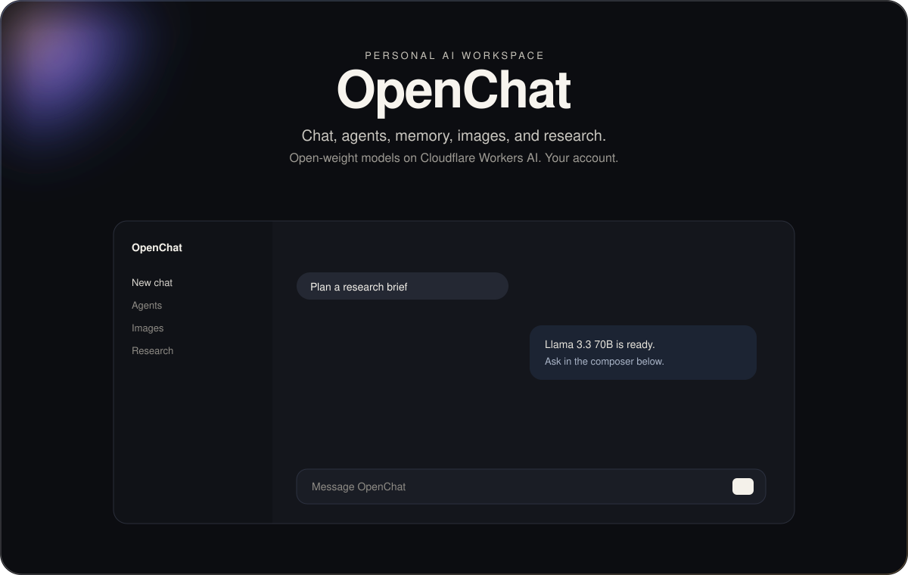

<p align="center">
  
</p>

<p align="center">
  Chat, agents, memory, files, goals, images, and research.<br>
  Open-weight models on Cloudflare Workers AI. Your account, not a hosted service.
</p>

<p align="center">
  Interface based on <a href="https://github.com/lobehub/lobe-chat">LobeChat</a>.<br>
  Maintainer: <a href="mailto:singhsarfaraz5507@gmail.com">singhsarfaraz5507@gmail.com</a>
</p>

<p align="center">
  
  &nbsp;
  
  &nbsp;
  
  &nbsp;
  
  &nbsp;
  
  &nbsp;
  
  &nbsp;
  
  &nbsp;
  
  &nbsp;
  
</p>

The header animation is the mark floating, the lights drifting, and a line moving under the name. The marks above are the same drawings the app uses in the model picker.

## What you can do

| | |
| --- | --- |
| **Talk** | Streaming chat with an agent. A topic is the saved conversation. |
| **Agents** | Persona, model, sampling, opening message, and attached files. |
| **Memory** | Optional. The app extracts memories after a reply and can forget them. |
| **Knowledge** | Upload text, embed it, and retrieve it under a reply. |
| **Goals** | A plan broken into tasks that run in order, with a pause for review. |
| **Images** | Generate with Workers AI. Remove a background or enhance when a Black Forest Labs key is set. |
| **Research** | A background report from a web search key, with a PDF you export in the browser. |

There is no SMTP server in this project. Password reset mail goes out through Cloudflare Email Service when you set `EMAIL_FROM`. Product emails are optional Customer.io. Nothing is sent until you add those yourself.

## Chat models

All of these run on Cloudflare Workers AI. The names are the open-weight models Cloudflare hosts. OpenChat does not call OpenAI, Google, Meta, or anyone else's API. The catalog is `src/shared/models.ts`. The default is Llama 3.3 70B.

| | Model | Best for |
| --- | --- | --- |
|  | Llama 3.3 70B | Everyday chat, analysis, and writing. |
|  | GPT-OSS 120B | Reasoning and long drafts. 128k context. |
|  | GPT-OSS 20B | Faster general chat. 128k context. |
|  | Llama 4 Scout | General assistant work. |
|  | Mistral Small 3.1 | Short answers and summaries. |
|  | DeepSeek V4 Pro | Hard reasoning. 1M context. |
|  | DeepSeek V4 Flash | Reasoning, quicker. 1M context. |
|  | DeepSeek R1 Distill 32B | Step-by-step technical thinking. |
|  | Qwen2.5 Coder 32B | Code. |
|  | Qwen3 30B | Multilingual general chat. |
|  | Qwen3.8 27B | Coding, reasoning, and multilingual chat. |
|  | GLM 5.2 | General chat and analysis. |
|  | GLM 5.3 | Harder reasoning. |
|  | GLM 5.3 Flash | Fast GLM replies. |
|  | Kimi K2.6 | Longer research-style conversation. |
|  | Kimi K2.7 Code | Implementation and code edits. |
|  | Gemma 4 26B | Vision and multimodal prompts. 256k context. |
|  | Nemotron 3 120B | Difficult reasoning. |
|  | Llama 3.1 8B | Short, cheap replies. |

Speech uses Whisper Large V3 Turbo. Knowledge and memory embeddings use `bge-m3` (1024 dimensions, cosine).

## Image models

| Model | Author |
| --- | --- |
| FLUX.2 Dev | Black Forest Labs |
| FLUX.2 Klein 9B | Black Forest Labs |
| FLUX.2 Klein 4B | Black Forest Labs |
| FLUX.1 Schnell | Black Forest Labs |
| Lucid Origin | Leonardo AI |
| Phoenix 1.0 | Leonardo AI |

## Run it

You need Node, pnpm 11, and a Cloudflare account of your own. This repository does not include anyone's keys or database.

```bash
pnpm install
cp .dev.vars.example .dev.vars
```

Set `CSRF_SECRET` to 32 or more random characters. Chat also needs `CLOUDFLARE_ACCOUNT_ID` and `CLOUDFLARE_API_TOKEN` (Workers AI only). Leave every other line empty until you want that feature.

```bash
pnpm db:migrate:local
pnpm dev
```

`pnpm db:migrate:local` touches only the local database. Before any deploy, create a D1 database in your account and replace the placeholder `database_id` in `wrangler.jsonc`. The steps are in [DEPLOY.md](./DEPLOY.md).

### Docker

Docker runs that same local Worker. It does not deploy, and it does not start the code-execution image in `sandbox/Dockerfile`.

```bash
cp .dev.vars.example .dev.vars
```

Set `CSRF_SECRET` in `.dev.vars`, then:

```bash
docker compose up --build
```

Open `http://localhost:5173`. The local D1 lives in the `openchat-local` volume, so the next start keeps the accounts you created. Chat still needs `CLOUDFLARE_ACCOUNT_ID` and `CLOUDFLARE_API_TOKEN` in `.dev.vars`.

| Variable | What stays off without it |
| --- | --- |
| `BFL_API_KEY` | Background removal and enhance |
| `TAVILY_API_KEY`, `PERPLEXITY_API_KEY`, or `SERPER_API_KEY` | Deep Research search. The first one set is used, in that order |
| `EMAIL_FROM` | Password-reset mail |
| `CUSTOMERIO_API_KEY` and `APP_URL` | Onboarding and re-engagement mail |
| `CRON_SECRET` | The email cron route |

## Stack

One Cloudflare Worker. Hono serves `/api/*`. A Vite and React Router app in `src/web` is the rest of the site. Data is D1. Files and images are R2. Embeddings are Vectorize. Memory, goals, and research run as Workflows. Code execution needs the container in `sandbox/` and stays off until you add it.

```bash
pnpm test
pnpm type-check
pnpm lint
pnpm build
```

## Secrets

Do not commit `.env` or `.dev.vars`. Both are gitignored. `.dev.vars.example` has empty values. Wrangler secrets are set with `wrangler secret put`, not in `wrangler.jsonc`. Tests use obvious stand-ins such as `cio-key`, not real credentials.

## License

This repository's own code is Apache-2.0. See [LICENSE](./LICENSE). Copyright 2026 [singhsarfaraz5507@gmail.com](mailto:singhsarfaraz5507@gmail.com).

The interface is based on [LobeChat](https://github.com/lobehub/lobe-chat) by [LobeHub](https://github.com/lobehub/lobehub). OpenChat does not include their source. Their project uses the LobeHub Community License. Read [ATTRIBUTION.md](./ATTRIBUTION.md) before you offer this to other organizations, white-label it, or resell it. The model marks in `docs/readme/logos` use the same geometry as the in-app picker.
