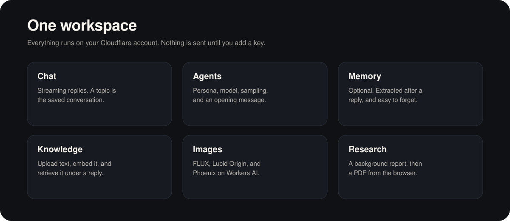
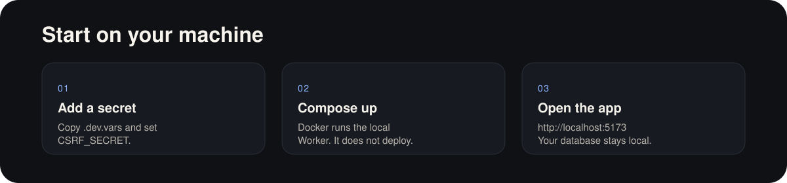

# OpenChat

Self-hosted AI workspace for Cloudflare Workers AI: chat, agents, memory, knowledge, images, and research on your own account.

<p align="center">
  
</p>

<p align="center">
  <a href="#start"></a>
  &nbsp;&nbsp;
  <a href="#models"></a>
</p>

<p align="center">
  Interface based on <a href="https://github.com/lobehub/lobe-chat">LobeChat</a>
  ·
  <a href="mailto:singhsarfaraz5507@gmail.com">singhsarfaraz5507@gmail.com</a>
</p>

<p align="center">
  
  &nbsp;
  
  &nbsp;
  
  &nbsp;
  
  &nbsp;
  
  &nbsp;
  
  &nbsp;
  
  &nbsp;
  
  &nbsp;
  
</p>



<a id="models"></a>

## Workers AI models

Open-weight models hosted by Cloudflare Workers AI. OpenChat does not call OpenAI, Google, Meta, or anyone else's API. The default is Llama 3.3 70B. The list lives in `src/shared/models.ts`.

| | Model | Best for |
| --- | --- | --- |
|  | Llama 3.3 70B | Everyday chat, analysis, and writing. |
|  | GPT-OSS 120B | Reasoning and long drafts. 128k context. |
|  | GPT-OSS 20B | Faster general chat. 128k context. |
|  | Llama 4 Scout | General assistant work. |
|  | Mistral Small 3.1 | Short answers and summaries. |
|  | DeepSeek V4 Pro | Hard reasoning. 1M context. |
|  | DeepSeek V4 Flash | Reasoning, quicker. 1M context. |
|  | DeepSeek R1 Distill 32B | Step-by-step technical thinking. |
|  | Qwen2.5 Coder 32B | Code. |
|  | Qwen3 30B | Multilingual general chat. |
|  | Qwen3.8 27B | Coding, reasoning, and multilingual chat. |
|  | GLM 5.2 | General chat and analysis. |
|  | GLM 5.3 | Harder reasoning. |
|  | GLM 5.3 Flash | Fast GLM replies. |
|  | Kimi K2.6 | Longer research-style conversation. |
|  | Kimi K2.7 Code | Implementation and code edits. |
|  | Gemma 4 26B | Vision and multimodal prompts. 256k context. |
|  | Nemotron 3 120B | Difficult reasoning. |
|  | Llama 3.1 8B | Short, cheap replies. |

Speech uses Whisper Large V3 Turbo. Knowledge and memory use `bge-m3`.

**Image models:** FLUX.2 Dev, FLUX.2 Klein 9B, FLUX.2 Klein 4B, FLUX.1 Schnell, Lucid Origin, Phoenix 1.0.

<a id="start"></a>

## Run it locally



```bash
cp .dev.vars.example .dev.vars
```

Set `CSRF_SECRET` to 32 or more random characters, then:

```bash
docker compose up --build
```

Open http://localhost:5173. The local database stays in the `openchat-local` volume. Chat also needs `CLOUDFLARE_ACCOUNT_ID` and `CLOUDFLARE_API_TOKEN` in `.dev.vars`.

Without Docker:

```bash
pnpm install
pnpm db:migrate:local
pnpm dev
```

`pnpm db:migrate:local` touches only the local database. [Deploy OpenChat on your own Cloudflare account](./DEPLOY.md). Docker does not deploy, and it does not start `sandbox/Dockerfile`.

| Variable | What stays off without it |
| --- | --- |
| `BFL_API_KEY` | Background removal and enhance |
| `TAVILY_API_KEY`, `PERPLEXITY_API_KEY`, or `SERPER_API_KEY` | Deep Research. The first key set is used, in that order |
| `EMAIL_FROM` | Password-reset mail, through Cloudflare Email Service. There is no SMTP server |
| `CUSTOMERIO_API_KEY` and `APP_URL` | Onboarding and re-engagement mail |
| `CRON_SECRET` | The email cron route |

Do not commit `.env` or `.dev.vars`. One Worker, a Vite React app, D1, R2, Vectorize, and Workflows.

```bash
pnpm test
pnpm type-check
pnpm lint
pnpm build
```

---

Apache-2.0. Copyright 2026 [singhsarfaraz5507@gmail.com](mailto:singhsarfaraz5507@gmail.com).

The interface is based on [LobeChat](https://github.com/lobehub/lobe-chat) by [LobeHub](https://github.com/lobehub/lobehub). This repository does not include their source. See [ATTRIBUTION.md](./ATTRIBUTION.md) and [LICENSE](./LICENSE).
